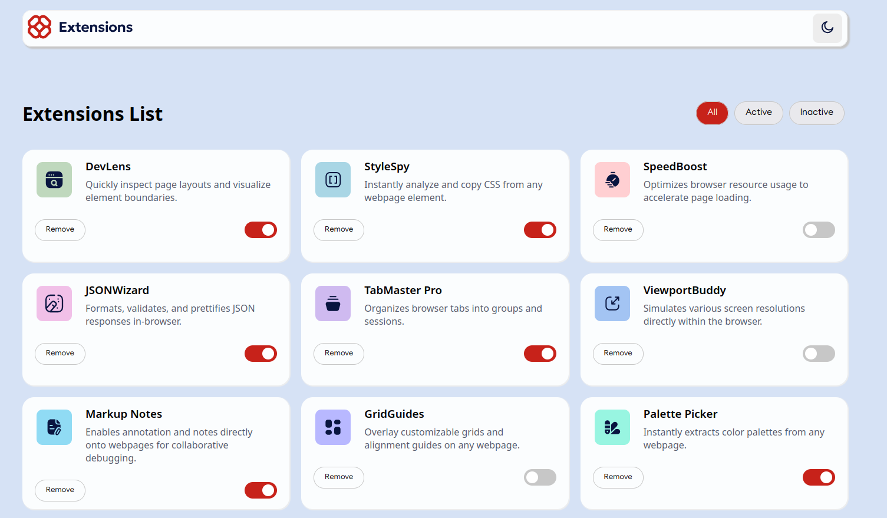
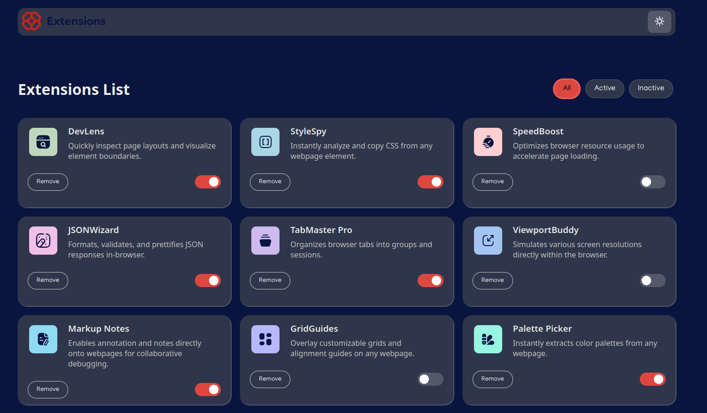

# Frontend Mentor - Browser extensions manager UI solution

This is a solution to the [Browser extensions manager UI challenge on Frontend Mentor](https://www.frontendmentor.io/challenges/browser-extension-manager-ui-yNZnOfsMAp). Frontend Mentor challenges help you improve your coding skills by building realistic projects. 

## Table of contents

- [Overview](#overview)
  - [The challenge](#the-challenge)
  - [Screenshot](#screenshot)
  - [Links](#links)
- [My process](#my-process)
  - [Built with](#built-with)
  - [What I learned](#what-i-learned)
  - [Continued development](#continued-development)
  - [Useful resources](#useful-resources)
  - [AI Collaboration](#ai-collaboration)
- [Author](#author)

## Overview

### The challenge

Users should be able to:

- Toggle extensions between active and inactive states
- Filter active and inactive extensions
- Remove extensions from the list
- Select their color theme
- View the optimal layout for the interface depending on their device's screen size
- See hover and focus states for all interactive elements on the page

### Screenshot
1. LIGHT THEME


2. DARK THEME


### Links

- Live Site URL: [Browser-Extension-Manager-UI](https://Mwalloh.github.io/Browser-Extension-Manager-UI)

## My process

### Built with

- [React](https://reactjs.org/) - JS library
- CSS Modules
- Flexbox
- CSS Grid

### What I learned

1. I learned how to use **CSS Modules**  in [React](https://reactjs.org), enabling me to define styles that should be local to a component.
2. I got to understand how to work with **state** and **props** in React, making me get a hint of how to manage global data like theme preferences, and how to pass data down the component tree.
3. I got to understand how to conditionally render data or components based on user actions in [React](https://reactjs.org).
  For example, in the code snippet below, I am changing the appearance (styling) of the button based on the values of **_filter_** and **_theme_**.
```js
<button
	onClick={() => setFilter("all")}
    className={
        filter === "all" ? 
            theme === "light" ? styles.filterBtn : styles.filterBtnDark 
        : ""
  }
>
    All
</button>
```

4. I learned how to persist data in the user's browser whenever the application is opened, using the browser's **localStorage** API. For example, in the code snippet below I am saving the initial theme to the browser.
```js
localStorage.setItem('theme', 'light')
```

### Continued development

I recently completed my learning journey of [React](https://reactjs.org) basics and I would love to build more React projects so that I may sharpen my frontend skills and be able to deliver when needed to.

### Useful resources

- [W3Schools](https://www.w3schools.com/howto/howto_css_switch.asp) - This helped me to implement the toggle switch of each extension card.

### AI Collaboration

Describe how you used AI tools (if any) during this project. This helps demonstrate your ability to work effectively with AI assistants.

- What tools did you use? 

    **GitHub Copilot**
- How did you use them? 

    **I used it to enable me learn new concepts and understand errors**

## Author

- Website - [Jim](https://mwalloh.github.io/MyPortfolio/)
- Frontend Mentor - [@Mwalloh](https://www.frontendmentor.io/profile/Mwalloh)
